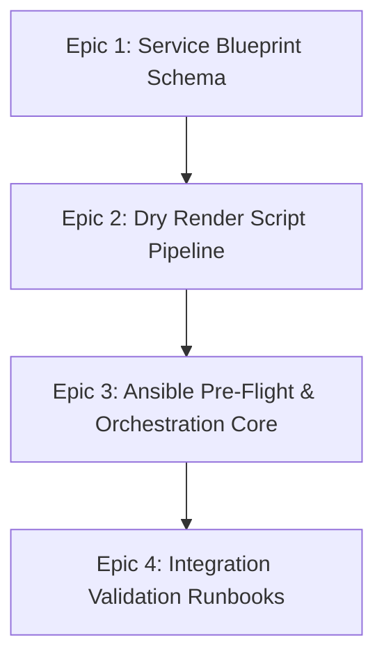

# Milestone 01: Core Blueprint Schema, Render Pipeline & Ansible Orchestration Foundation

- **Status:** Approved / Target for Execution
- **Target File Path:** `docs/milestones/01-foundation-and-dry-render-pipeline.md`
- **Primary Objectives:** Deliver the foundational blueprint configuration schemas, the "Dry" render compilation engine, and the core Ansible pre-flight assertion playbooks.
- **Governance Alignment:** [ADR-0001](../adr/0001-cloud-agnostic-multi-tier-baseline.md)[cite: 2], [ADR-0002](../adr/0002-kuma-universal-sdn-and-dry-render-architecture.md)[cite: 2], [ADR-0004](../adr/0004-standardize-ansible-as-unified-idempotent-orchestration-engine.md)[cite: 2], [Git Workflow](../versioning/git-workflow.md)[cite: 2].

---

## 1. Executive Summary & Epics

Milestone 01 establishes the working baseline code for the decoupled multi-tier platform simulation. It translates the high-level architecture designs in `docs/architecture/` into executable shell, JSON, and Ansible artifacts without introducing vendor lock-in or host-level route collisions.



## 2. Epics & User Stories Breakdown

### Epic 1: Service Blueprint Schema Definition

**Target Branch:** `infra/blueprint-schema-baseline`
**Deliverables:** `blueprints/platform-services.json`

- **Story 1.1**: Define the JSON schema for Tier 1 (ECCS), Tier 2/3 (Ingress/Gateway), and Tier 4 (Kubernetes Workloads).
- **Story 1.2**: Embed Kuma SDN metadata tags (`kuma.io/service`, `tier`, `mesh`) directly into abstract service declarations.
- **Acceptance Criteria**: `jq empty blueprints/platform-services.json` evaluates with zero errors.

### Epic 2: "Dry" Manifest Rendering Pipeline

**Target Branch:** `feature/dry-render-pipeline`
**Deliverables:** `scripts/render-manifests.sh`

- **Story 2.1**: Implement a shell script that ingests `blueprints/platform-services.json` and compiles transient, tagged deployment files into `docs/compiled-manifests/dataplanes/`.
- **Story 2.2**: Ensure directory creation, clean teardown of stale transients, and strict POSIX compliance.
- **Acceptance Criteria**: Executing `scripts/render-manifests.sh` generates valid YAML/JSON data-plane definitions in `docs/compiled-manifests/dataplanes/` without third-party binary tool dependencies.

### Epic 3: Ansible Orchestration & Pre-Flight Capacity Guardrails

**Target Branch:** `infra/ansible-bootstrap-core`
**Deliverables:** `playbooks/requirements.yml`, `playbooks/bootstrap-platform.yml`

- **Story 3.1**: Define `playbooks/requirements.yml` declaring required collections (`community.docker`) to manage system container nodes.
- **Story 3.2**: Implement `playbooks/bootstrap-platform.yml` embedded with capacity assertion tasks that invoke `scripts/profile-host.sh` within the container context to guarantee resource limits do not break the 16 GB RAM and 8 vCPUs workspace bounds.
- **Story 3.3**: Configure Ansible task tagging parameters (`render`, `compute`, `networking`, `github-setup`) to isolate control scopes cleanly.
- **Acceptance Criteria**: Executing the setup sequence via `bash scripts/sandbox-run.sh "ansible-playbook playbooks/bootstrap-platform.yml --tags 'render'"` completes host profiling checks and evaluates templates with an idle capacity drawing footprint of absolute zero.

### Epic 4: Validation & Teardown Playbooks

**Target Branch:** `feature/validation-teardown-playbooks`
**Deliverables:** `playbooks/validate-platform.yml`, `playbooks/teardown-platform.yml`

- **Story 4.1**: Create non-destructive validation playbooks (`playbooks/validate-platform.yml`) utilizing `community.docker.docker_container_info` to audit local node operational status and ensure zero-trust Kuma mesh API availability.
- **Story 4.2**: Create an emergency workspace evacuation playbook (`playbooks/teardown-platform.yml`) to clear platform containers and transient file layers, reclaiming workstation capacity cleanly back to zero.
- **Acceptance Criteria**: Running `bash scripts/sandbox-run.sh "ansible-playbook playbooks/teardown-platform.yml"` flushes all active container elements and unlinks dynamic blueprints seamlessly.

---

## 3. Milestone Execution Sequence & PR Flow

All pull requests must route changes strictly through prefix-enforced topic branches targeting `develop` and evaluate pre-flight layers before committing:

```bash
# 1. Start from updated integration baseline branch
git switch develop
git pull --ff-only origin develop

# 2. Create topic branch for active milestone delivery
git switch -c infra/ansible-bootstrap-core

# 3. Develop, validate using local sandbox execution gates
bash scripts/sandbox-run.sh "jq empty docs/compiled-manifests/governance/protect-gitflow.json"
bash scripts/sandbox-run.sh "bash scripts/validate-blueprint.sh blueprints/platform-services.json"
bash scripts/sandbox-run.sh "sh scripts/render-manifests.sh && sh scripts/test-render-manifests.sh"
bash scripts/sandbox-run.sh "bash scripts/compile-changelog.sh"
test -f KANBAN.md && grep -q "Active Focus Boundary" KANBAN.md
git diff --check

# 4. Stage artifacts, verify patch trailing whitespaces, and commit
git add playbooks/bootstrap-platform.yml playbooks/requirements.yml
git diff --cached --check
git commit -m "infra: implement sandbox-compliant pre-flight capacity assertions"

# 5. Open Pull Request to develop branch using GitHub CLI
git push --set-upstream origin infra/ansible-bootstrap-core
gh pr create --base develop --title "infra: implement pre-flight capacity assertions" --body "Delivers Epic 3 for Milestone 01."
gh pr checks --watch --fail-fast

# 6. Merge passing pipelines via explicit merge commits and delete branch
gh pr merge --merge --delete-branch
git switch develop
git pull --ff-only origin develop
```

## 4. Definition of Done (DoD) for Milestone 01

1. [x] `blueprints/platform-services.json` created and verified via `jq` parsing assertions.
2. [x] `scripts/render-manifests.sh` tested inside the OCI environment, outputting transient data under `docs/compiled-manifests/dataplanes/`.
3. [x] `playbooks/bootstrap-platform.yml` completes pre-flight resource monitoring thresholds without workstation drift.
4. [x] `playbooks/validate-platform.yml` and `playbooks/teardown-platform.yml` created and executing within container cgroups.
5. [x] `scripts/compile-changelog.sh` evaluates log streams, reconciling historical user stories (1.1, 1.2, 2.1, 2.2) perfectly inside `KANBAN.md`.
6. [x] All pull requests merged into `develop` through explicit merge commits (`--merge`) with active verification checks passing.
