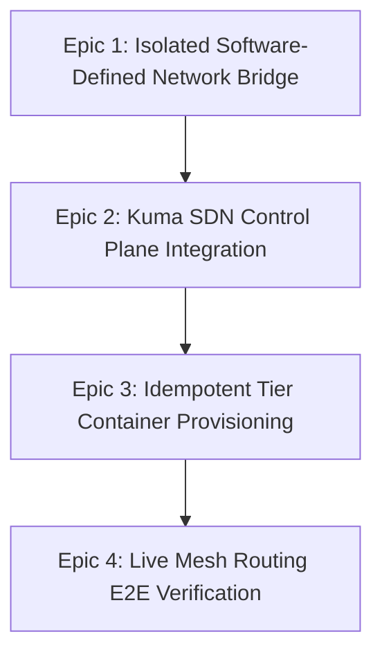

# Milestone 02: Live Container Orchestration & Kuma SDN Fabric Integration

- **Status:** Implemented / Verified by live end-to-end acceptance (`scripts/test-orchestrate-platform.sh`)
- **Target File Path:** `docs/milestones/02-live-container-orchestration.md`
- **Primary Objectives:** Provision the software-defined bridge networks, deploy the Kuma SDN Control Plane container, orchestrate the tier container cgroup pools idempotently, and execute secure edge-traffic proxy validation rules.
- **Governance Alignment:** [ADR-0001](../adr/0001-cloud-agnostic-multi-tier-baseline.md), [ADR-0002](../adr/0002-kuma-universal-sdn-and-dry-render-architecture.md), [ADR-0004](../adr/0004-standardize-ansible-as-unified-idempotent-orchestration-engine.md), [ADR-0005](../adr/0005-adopt-containerized-sandbox-dev-environment.md).

---

## 1. Executive Summary & Epics

Milestone 02 transforms the declarative, compiled templates from Milestone 01 into an active multi-tier infrastructure simulation. By driving the local host Docker daemon socket through the containerized sandbox plane, it initializes an enterprise-grade SDN environment within strict hardware guardrails.



## 2. Epics & User Stories Breakdown

### Epic 1: Isolated Software-Defined Network Bridge

**Target Branch:** `infra/docker-network-fabric`
**Deliverables:** `playbooks/tasks/network-bridge.yml`

- **Story 1.1:** Implement an Ansible task using `community.docker.docker_network` to define a dedicated bridge network named `platform-simulation-net` with MTU boundaries set to `1500`.
- **Story 1.2:** Inject dynamic metadata labels into the network lifecycle layer to isolate it from external developer stack topologies.
- **Acceptance Criteria:** `docker network inspect platform-simulation-net` shows a stable network footprint.

### Epic 2: Kuma SDN Control Plane Integration

**Target Branch:** `feature/kuma-control-plane-bootstrap`
**Deliverables:** `playbooks/tasks/kuma-cp-core.yml`

- **Story 2.1:** Implement an idempotent container allocation blueprint targeting `kuma-control-plane` using pinned components (`docker.io/kong/kuma-cp:2.9.1`).
- **Story 2.2:** Build a robust `ansible.builtin.uri` validation loop that queries the API endpoint `http://localhost:5681/meshes` with an exponential backoff retry mechanism (Max 10 attempts).
- **Acceptance Criteria:** The playbook continues execution only after receiving an HTTP status code `200` from the Kuma API.

### Epic 3: Idempotent Tier Container Provisioning

**Target Branch:** `infra/tier-container-orchestration`
**Deliverables:** `playbooks/tasks/provision-tiers.yml`

- **Story 3.1:** Implement loop routines that parse `blueprints/platform-services.json` to spawn active infrastructure workloads (`eccs-compute-nodes`, `calbs-cagis-ingress`, `mkrs-k8s-workload`).
- **Story 3.2:** Explicitly map cgroup capacity caps (`cpus`, `memory`) directly into the docker runtime configs to protect developer machine stability. Caps are `eccs-compute-nodes` 5 CPU / 10240 MB, `calbs-cagis-ingress` 1 CPU / 2048 MB and `mkrs-k8s-workload` 1 CPU / 2048 MB; with the Kuma control plane (1 CPU / 2048 MB) the stack totals exactly 8 vCPU / 16 GB.
- **Acceptance Criteria:** All containers report a state of `running` and match their allocated resource constraints exactly.

### Epic 4: Live Mesh Routing E2E Verification

**Target Branch:** `feature/mesh-routing-validation`
**Deliverables:** `playbooks/validate-platform.yml` (Updated), `playbooks/tasks/mesh-bootstrap.yml`, `playbooks/orchestrate-platform.yml`

- **Story 4.1:** Update the active platform validation suite to parse and assert Kuma Dataplane data structures on-the-fly via the live control plane catalog.
  Implemented by `playbooks/tasks/validate-mesh-catalog.yml` (included from `validate-platform.yml`): GET `/meshes/platform-simulation-vpc/dataplanes`, then assert each blueprint tier is registered and its `kuma.io/service` token matches `blueprints/platform-services.json`. A real run needs the sandbox on the host network to reach `localhost:5681`; override with `-e kuma_api_url=...`. Covered by `scripts/test-validate-mesh-catalog.sh`.
- **Story 4.2:** Integrate a test assertion block to verify zero-trust path isolation between unauthenticated zones.
  Implemented by `playbooks/tasks/validate-path-isolation.yml` (included from `validate-platform.yml`): asserts the mesh enforces an mTLS backend with no allow-all `TrafficPermission`, then probes `calbs-cagis-ingress` -> `mkrs-k8s-workload` over plaintext (`nc`, default port 8080, override `isolation_target_port`) and requires the connection to be rejected. The play ends with a summary task reached only when every check passed. Covered by `scripts/test-validate-path-isolation.sh`.
- **Acceptance Criteria:** Executing `ansible-playbook playbooks/validate-platform.yml` successfully completes all validation checks with zero task failures.

---

## 3. Entry Points & Live Acceptance

```bash
# Bring the whole stack up (idempotent): network -> Kuma CP -> health gate -> tiers -> zero-trust mesh + Dataplanes
bash scripts/sandbox-run.sh "ansible-playbook playbooks/orchestrate-platform.yml"
# Epic 4 acceptance: zero task failures against the live stack
bash scripts/sandbox-run.sh "ansible-playbook playbooks/validate-platform.yml"
# Tear down
bash scripts/sandbox-run.sh "ansible-playbook playbooks/teardown-platform.yml"
```

- `playbooks/tasks/mesh-bootstrap.yml` creates the blueprint mesh with mTLS and no initial allow-all policies, then registers one Dataplane per tier through the Kuma REST API (delegated gateway for `calbs-cagis-ingress`). The tier containers are simulation workloads without a `kuma-dp` sidecar, so registration is declarative rather than proxy-driven.
- The sandbox shares the host network (`--network host`) so `localhost:5681` is the workstation's published Kuma port.
- `scripts/test-orchestrate-platform.sh` proves the Acceptance Criteria live: orchestration, idempotency (`changed=0`), `validate-platform.yml` passing, and detection of an injected allow-all `TrafficPermission` and a drifted `kuma.io/service` token. It refuses to run if the real stack already exists and clamps CPU caps only when the daemon has fewer CPUs than the blueprint requests (4-vCPU CI runners).

## 4. Operational Execution Sequence & PR Flow (Epic 1 reference; later epics follow the same flow)

````bash
# 1. Initialize Git branch context from develop
git switch develop
git pull --ff-only origin develop
git switch -c infra/docker-network-fabric

# 2. Trigger Local Pre-Flight Checks to guarantee baseline health
bash scripts/sandbox-run.sh "jq empty docs/compiled-manifests/governance/protect-gitflow.json"
bash scripts/sandbox-run.sh "bash scripts/validate-blueprint.sh blueprints/platform-services.json"
bash scripts/sandbox-run.sh "sh scripts/render-manifests.sh && sh scripts/test-render-manifests.sh"
git diff --check

# 3. Stage changes, perform cached whitespace checks, and commit under Conventional guidelines
git add playbooks/tasks/network-bridge.yml
git diff --cached --check
git commit -m "infra: implement software-defined docker bridge network fabric for Epic 1"

4. Open Pull Request and stream remote CI status gates via GitHub CLI

```bash
git push --set-upstream origin infra/docker-network-fabric
gh pr create --base develop --title "infra: implement software-defined docker network bridge" --body "Delivers Epic 1 for Milestone 02."
gh pr checks --watch --fail-fast
````

5. Execute explicit merge commits and synchronize local branch tracking points

```bash
gh pr merge --merge --delete-branch
git switch develop
git pull --ff-only origin develop
```
