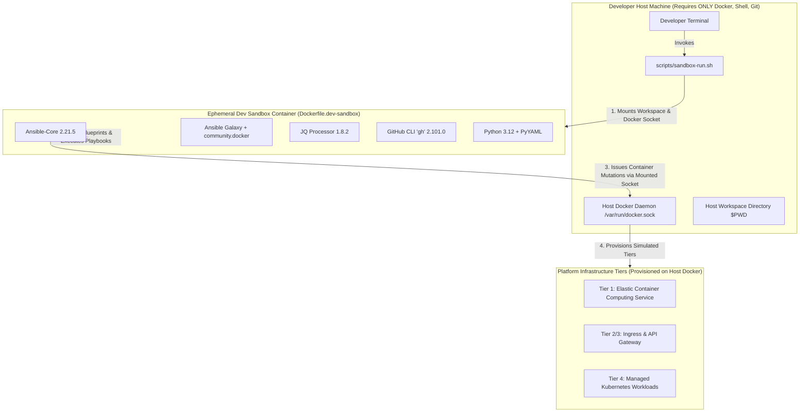

# Operational Excellence: Ephemeral Sandbox Container Architecture

This guide details the technical design, execution mechanics, and containerized runtime configuration for the platform sandbox environment.

## 1. Sandbox Architecture Mapping

The Sandbox Container abstracts the orchestration plane from the host hardware. Commands executed via `scripts/sandbox-run.sh` launch a transient container with mounted sockets, providing access to the host's Docker engine while executing all logic inside the insulated container image.

## 2. Strategic Alignment

This operational setup satisfies the mandate defined under [ADR-0005](../adr/0005-adopt-containerized-sandbox-dev-environment.md). By executing all workflows synchronously within an interactive or single-invocation container with `--rm` flags, the background footprint drops completely to zero when idle.
