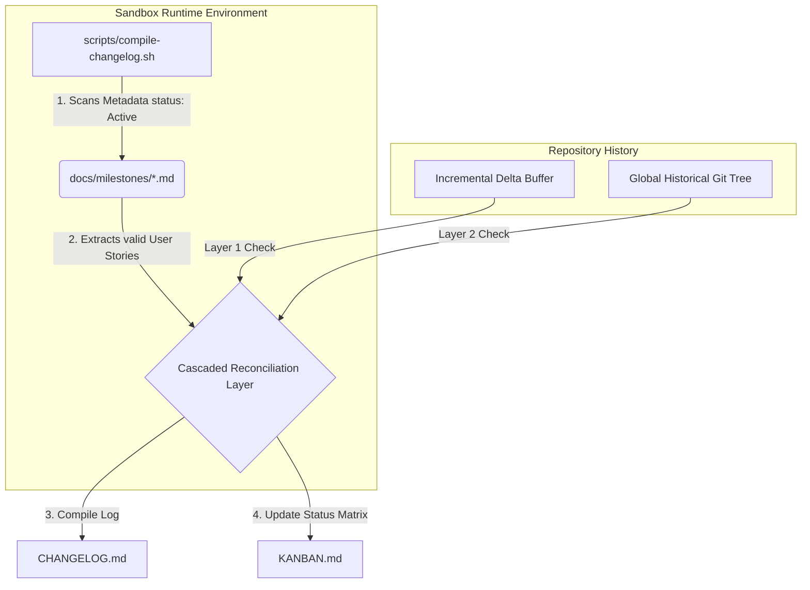

# Operational Excellence: Milestone-Aware Changelog & Dynamic Kanban Board Pipeline

This document defines the architecture, data structures, and automation runbooks governing the zero-dependency repository log streaming pipeline.

## 1. Architectural Strategy & Token Optimization

To optimize context token space and avoid package inflation (e.g., Node/npm or Rust binaries), the workspace leverages a **POSIX-Native Git Stream Processor** (`scripts/compile-changelog.sh`).

The pipeline runs synchronously inside the decoupled sandbox container environment, scanning metadata logs and converting Conventional Commits into structured documentation items on-the-fly.



## 2. Multi-Tiered Historical Reconciliation Logic

To ensure that User Stories delivered prior to initializing this framework (e.g., Stories 1.1, 1.2, 2.1, 2.2) do not float backwards into the backlog column, the compiler script evaluates code states using four distinct cascading levels:

1. **Layer 1 (Unreleased Stream):** Evaluates the active incremental delta buffer (`LAST_TAG..TARGET_BRANCH`). If an item is found, it is logged under the active milestone context.
2. **Layer 2 (Historic Git Graph):** Searches the entire repository log graph (`git log --all`). If the user story token is matched in a past commit string, it resolves to completed.
3. **Layer 3 (Permanent Storage Logs):** Inspects the compiled `CHANGELOG.md` file artifact directly to handle historical squash merges safely.
4. **Layer 4 (Fallback Exclusion):** If no matching token exists across any layer, the task defaults to the `🟥 BACKLOG / TODO` row.

## 3. Automated Kanban Grid Synthesis

The compiler automatically outputs `KANBAN.md` using clean, compact markdown grid blocks. Tasks are organized under three explicit columns based on resolved state machine mappings:

- **🟥 BACKLOG / TODO:** Unexecuted or planned user stories.
- **🟨 IN PROGRESS:** Actively tracked development branch elements.
- **🟩 DONE (VERIFIED IN DEV/DEVELOP):** Completed, integrated, and verified milestone artifacts.

## 4. Operational Runbook

Invoke the pipeline compiler from the repository root inside the sandbox wrapper:

```bash
# Compile delta changelogs and synthesize the dynamic Kanban matrix
bash scripts/compile-changelog.sh

# Verify output consistency via pre-flight checks
test -f KANBAN.md && grep -q "Active Focus Boundary" KANBAN.md
```
